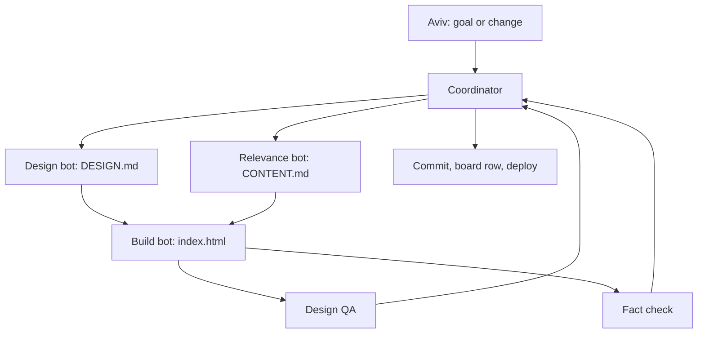

# aviv-site (Agent Guide)

Source of truth for every AI agent working on Aviv Pinto's personal site. `CLAUDE.md` only points here. The setup is adapted from the CallIt repo (`Yuval-Gerber/CallIt`): lanes, a bulletin board, and one coordinator who owns Git.

## Start every session here

1. Read `.agent-owner` (gitignored; holds `Aviv`). If it is missing, ask, then create it.
2. Read [`docs/BULLETIN.md`](docs/BULLETIN.md). Act on rows that @-mention your lane.
3. Read [`docs/CONTENT.md`](docs/CONTENT.md) and [`docs/DESIGN.md`](docs/DESIGN.md) before touching the page.
4. Take the task from the coordinator, or from Aviv.

## Bot lanes

Each assignment goes to one bot. A bot edits only the files in its lane. Cross-lane needs go on the board with an @-mention.

| Bot | Handle | Job | Owns |
|-----|--------|-----|------|
| Coordinator | `@coord` | Splits work, assigns lanes, integrates, owns every Git action and board update | `AGENTS.md`, `docs/BULLETIN.md`, Git |
| Design | `@design` | Visual system: tokens, type, layout, motion, mobile, dark and light | `docs/DESIGN.md`, `assets/style.css` |
| Relevance | `@relevance` | Picks what goes on the site for the audience (quant trading, quant research, AI engineering) and what stays off | `docs/CONTENT.md` |
| Build (coordinator) | `@build` | Assembles the page from partials; nav, exhibits B to F, skills, about, contact | `index.html`, `assets/main.js`, `assets/style.css`, `scripts/` |
| Hero | `@build-hero` | 3D order-book terrain hero | `partials/hero.html`, `assets/terrain/` |
| Story | `@build-story` | Exhibit A: the scroll-told lobkit story | `partials/lobkit-story.html`, `assets/story/` |
| Terminal | `@build-terminal` | The alternate terminal mode | `terminal/` |
| v3 World | `@world` | v3 fixed contour-map world, camera flight, map key | `partials/v3-world.html`, `assets/v3/world.*` |
| v3 Markets | `@markets` | v3 sites 01 to 04 (Kalshi, stat-arb, SPAC warrants, OMS) | `partials/v3-markets.html`, `assets/v3/markets.*` |
| v3 Field | `@field` | v3 sites 05 to 07 (Lionheart, builds, survey office) | `partials/v3-field.html`, `assets/v3/field.*` |
| Design QA | `@qa-design` | Read-only review: contrast, responsive, motion, slop check | nothing (reports only) |
| Fact check | `@qa-facts` | Read-only review: every claim and number traces to a source in CONTENT.md; every link resolves | nothing (reports only) |

Agent profiles live in `.claude/agents/` (`reviewer`, `debugger`). Reviewers are read-only. The coordinator validates findings before anyone fixes them.

## Pipeline



Design and Relevance run in parallel. Build waits for both. Both QA bots review the same commit.

## Rules

- **No invented content.** Every number, date, role and link on the page must trace to a source line in `docs/CONTENT.md`. Unknown stays out, not guessed.
- **No confidential work.** Client, PE or deal projects never appear, even by description.
- **Plain static site.** `index.html` + `assets/`. No build step until the MVP needs one.
- **Accessibility floors.** WCAG AA contrast in both themes, keyboard focus visible, `prefers-reduced-motion` respected, works at 360px wide.
- **Writing style.** No em dashes. Short sentences. No hype words ("passionate", "cutting-edge", "leverage").
- **Record checks honestly.** A check that did not run is not a pass.

## Bulletin Board

`docs/BULLETIN.md`, newest row on top. Columns: date `YYYY-MM-DD`, time `HH:MM` from the system clock, author (the person, then the bot lane), message. End anything unfinished with `**OPEN:**`.

## Commands

```sh
python3 scripts/assemble.py   # splice partials/*.html into index.html (between <!-- partial:NAME --> markers)
python3 scripts/charts.py     # regenerate data charts in index.html
python3 -m http.server 4321   # preview at http://localhost:4321 (terminal mode at /terminal/)
```

Lanes never edit `index.html` directly: they own a partial, and the coordinator runs `assemble.py`. Prototypes live in `explorations/` and are not linked from the site.

Deploy: any static host (GitHub Pages or Vercel, both free). A domain is the only cost.
